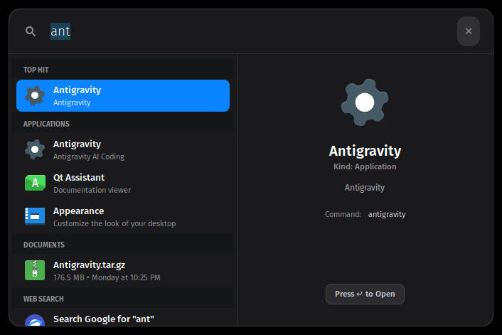

# macOS Spotlight for Linux

A native, ultra-responsive replica of **macOS Sonoma / Sequoia Spotlight Search** for Linux desktops. 

Built with GTK+ 3, Python, Cairo, and an optimized C IPC client, it opens in under **5 milliseconds** with <kbd>Alt</kbd>+<kbd>Space</kbd> and stays persistent across system restarts.



---

## ✨ Features

- **Pixel-Perfect macOS Aesthetic**:
  - Dark frosted acrylic glass background (`rgba(28, 28, 30, 0.94)`) with smooth 16px rounded corners, subtle 1px border, and drop shadow.
  - Minimalist magnifying glass search icon and placeholder typography.
  - Dynamically expands into the iconic **2-Column Split View** (Results list on left, Rich Inspector/Preview Pane on right).
  - Automatically collapses back to the sleek single search bar when query is cleared.
  - macOS blue selection pill (`#0a84ff`) with smooth arrow key navigation.

- **⚡ Sub-5ms Instant Activation**:
  - **Pre-warmed in RAM**: Runs as a lightweight resident daemon (`~24 MB` RAM) with the GTK window and application index pre-loaded into memory.
  - **Zero Process Spawning Lag**: Window unhiding happens in `< 5ms`.
  - **Compiled C Toggle**: Includes an ultra-low latency C client (`spotlight-toggle`) communicating over local UNIX domain sockets in `< 2ms`.

- **🧮 Instant Calculations & Unit Conversions**:
  - Direct arithmetic: `2+2`, `15 * 84 + 120`, `2^10`, `(100 / 4) * 5`
  - Percentages: `15% of 200`, `100 + 20%`, `500 - 10%`
  - Math functions: `sqrt(144)`, `sin(pi/2)`, `log10(1000)`, `abs(-55)`
  - Unit conversions: `100 km to miles`, `32 f to c`, `10 kg to lbs`, `1024 mb to gb`
  - Base conversions: `0xff in dec` (255), `42 to bin` (`0b101010`), `42 to hex` (`0x2a`)
  - Press <kbd>Enter</kbd> to copy the result directly to your clipboard.

- **🚀 Application Launcher with Frecency**:
  - Pre-indexes all system and user `.desktop` applications.
  - Prefix matching, acronym matching (e.g. `gc` for Google Chrome, `vsc` for Visual Studio Code), and fuzzy search.
  - Automatically tracks usage ("frecency") so your most frequently launched apps appear first.
  - Detailed preview pane showing application icon (80px), name, description, categories, executable path, and launch action.

- **📁 Files & Documents Search**:
  - Searches recent documents (`~/.local/share/recently-used.xbel`) and user directories (`~/Documents`, `~/Downloads`, `~/Pictures`, `~/Desktop`).
  - Preview pane displays file size, modified date, mime type, and path.
  - Press <kbd>Enter</kbd> to open with default app; press <kbd>Shift</kbd>+<kbd>Enter</kbd> to reveal in your file manager.

- **⚙️ System Actions**:
  - Type `lock` → Lock Screen
  - Type `sleep` / `suspend` → Put computer to sleep
  - Type `restart` / `reboot` → Restart system
  - Type `shutdown` / `power off` → Turn off computer
  - Type `logout` → Log out of desktop session
  - Type `settings` → Open System Settings
  - Type `empty trash` → Empty trash bin

- **🌐 Web & Terminal Fallbacks**:
  - Press <kbd>Enter</kbd> on any query to search Google in your default browser.
  - Prefix query with `>` or `$` to execute commands in terminal (e.g. `> top` or `$ ping 8.8.8.8`).
  - Type any URL (`https://...` or `www...`) to open directly in your browser.

- **🔄 Persistent Across Laptop Restarts**:
  - Seamlessly re-launches after reboot via **Systemd User Unit** (`systemctl --user enable spotlight.service`) and **XDG Autostart**.
  - Dynamic `DISPLAY` and `XAUTHORITY` detection handles session changes effortlessly.
  - Automatically unblocks window manager shortcut conflicts (`activate-window-menu`) so <kbd>Alt</kbd>+<kbd>Space</kbd> is always available.

---

## 🚀 1-Command Installation

Run this single command in your terminal on any Linux distribution (Arch, CachyOS, Ubuntu, Debian, Mint, Fedora, openSUSE):

```bash
curl -fsSL https://raw.githubusercontent.com/BestFortune/macos-spotlight/main/install.sh | bash
```

The installer automatically:
1. Detects your distribution package manager (`pacman`, `apt`, `dnf`, `zypper`) and installs required packages (`python3-gi`, `gtk3`, `keybinder3`, `gcc`).
2. Compiles the optimized C toggle binary.
3. Installs daemon and desktop files to `~/.local/share/macos-spotlight/` and `~/.local/bin/`.
4. Configures the <kbd>Alt</kbd>+<kbd>Space</kbd> global shortcut and clears window manager conflicts.
5. Enables and starts the systemd user service so it's running immediately and on every boot.

---

## ⌨️ Keyboard Shortcuts

| Shortcut | Action |
| :--- | :--- |
| <kbd>Alt</kbd> + <kbd>Space</kbd> | Open or Close Spotlight instantly |
| <kbd>Esc</kbd> | Dismiss Spotlight immediately |
| <kbd>↓</kbd> / <kbd>↑</kbd> | Navigate search results list |
| <kbd>Enter</kbd> | Launch selected app, execute system action, or copy calculation |
| <kbd>Shift</kbd> + <kbd>Enter</kbd> | Reveal selected file in file manager |
| Clicking outside window | Automatically dismisses Spotlight |

---

## 🗑️ Uninstallation

To cleanly remove macOS Spotlight and restore original desktop shortcut settings:

```bash
curl -fsSL https://raw.githubusercontent.com/BestFortune/macos-spotlight/main/uninstall.sh | bash
```

Or from a local clone:

```bash
./uninstall.sh
```

---

## 📄 License

MIT License. See [LICENSE](LICENSE) for details.
